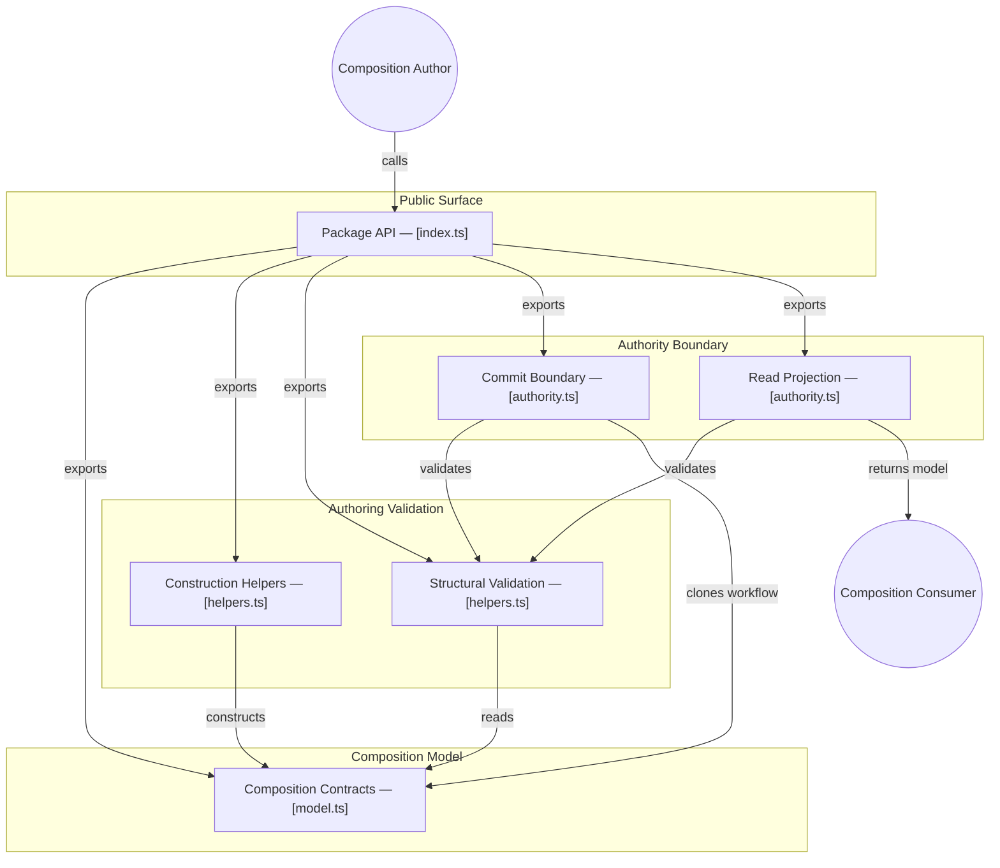

# GitDiagram architecture — @konitif/composition

This architecture view was generated from the public repository by [GitDiagram](https://gitdiagram.com/lemouf/konitif-composition) on 2026-09-20 18:43:54 UTC.

It is a documentation projection of the repository tree, README, and source files sampled by GitDiagram. It does not replace the authored contracts in [catalog.json](catalog.json) and [diagrams.json](diagrams.json), nor does it establish runtime authority.

The Mermaid source keeps GitDiagram's groups, nodes, relationships, and source links. GitDiagram's forced color classes and HTML line breaks are omitted so the diagram remains readable in local previews and dark themes.

- Public repository: [konitif-composition](https://github.com/LeMouf/konitif-composition)
- Interactive diagram: [Open in GitDiagram](https://gitdiagram.com/lemouf/konitif-composition)

## Architecture diagram

## Generated analysis

@konitif/composition is a small TypeScript library for defining and governing authored executable compositions. A caller creates workflows and modules through pure helpers, validates structural relationships, then submits a candidate to the commit boundary; valid candidates are cloned and accepted, while invalid ones preserve the previous workflow. Callers can also project a validated read model. The sampled source confirms contracts, construction, validation, cloning, commit, and projection; editors and runtimes are documented consumers but are not implemented here.
